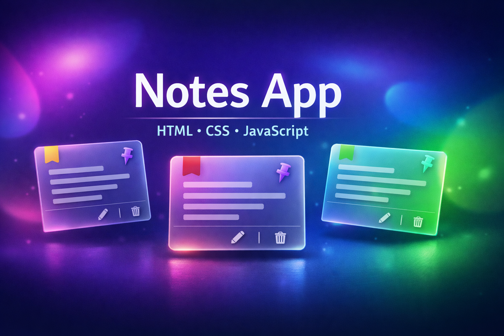
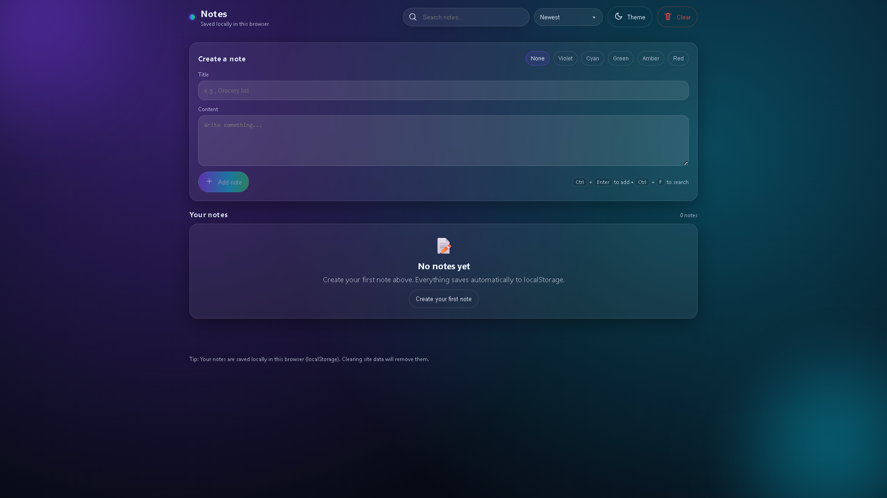
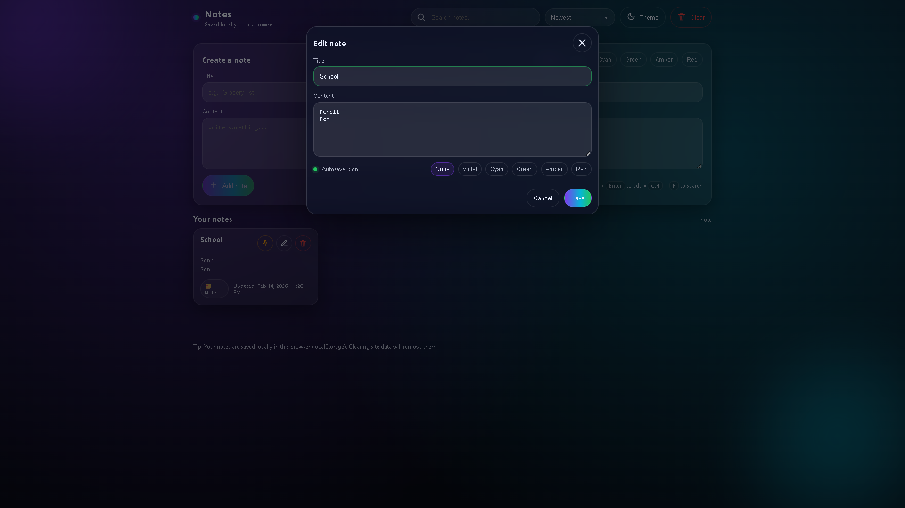

# 🚀 09 - Simple Web Projects: **Notes App** (HTML, CSS, JavaScript)

<p align="center">
  
</p>

[](LICENSE)


This is the ninth project in the **Simple Web Projects** series — a clean, modern, fully responsive **Notes App** built with pure **HTML, CSS, and Vanilla JavaScript**.

It uses **localStorage** for persistence and supports adding, editing, deleting, searching, pinning, and sorting notes with a smooth **gradient + glass UI** and subtle animations — **no frameworks, no build tools, no libraries**.

> ⚠️ **Disclaimer:** “Notes App” is only the project name — it is not my personal name.

------------------------------------------------------------------------

## ✨ Features

- Add, edit, and delete notes
- Notes persist using **localStorage**
- Edit notes in a smooth modal (ESC / click outside to close)
- Autosave while editing (debounced)
- Pin / unpin important notes
- Real-time search (title + content)
- Sort options: Newest / Oldest / Recently Updated
- Color tags for notes
- Smooth animations (card hover, add/remove, modal, toasts)
- Toast notifications for actions
- Sticky top bar with glass scroll effect
- Dark / Light theme toggle (CSS variables)
- Back-to-top smooth scroll button
- Fully responsive & accessible
- `prefers-reduced-motion` support

------------------------------------------------------------------------

## 📸 Screenshots

### Home / Notes Grid


### Edit Note Modal


------------------------------------------------------------------------

## 🚀 Getting Started

1. **Clone this repository**
```bash
git clone https://github.com/vishal-git-dot/09-simple-web-projects-html-css-js.git
```

2. **Navigate to the project folder**
```bash
cd notes-app
```

3. **Open index.html in your browser**
```bash
# No server required
```

------------------------------------------------------------------------

## 🧠 JavaScript Concepts Used

| Concept | Description |
|------|------------|
| localStorage | Persist notes across page reloads |
| Arrays / Objects | Store and manage notes data |
| DOM manipulation | Render note cards dynamically |
| Event delegation | Handle edit / delete / pin actions |
| Debouncing | Smooth autosave & search |
| Timers | Toast auto-dismiss |
| Conditionals | UI state & validation |
| Simple state machine | idle → editing → saving → deleting |

------------------------------------------------------------------------

## 📁 File Structure

```text
notes-app/
├── index.html
├── styles.css
├── script.js
└── assets/
    ├── banner-notes-app.png
    ├── screenshot-home.png
    └── screenshot-edit.png
```

------------------------------------------------------------------------

## 📚 Project Series Overview

| # | Project Name | Skills | Features |
|--|-------------|-------|----------|
| ✅ 01 | To-Do List App | DOM, localStorage | Add/edit/delete |
| ✅ 02 | Calculator | Logic, CSS Grid | Arithmetic |
| ✅ 03 | Weather App | Fetch API | City search |
| ✅ 04 | Digital Clock | Time API | Live time |
| ✅ 05 | Quiz App | Events, logic | MCQs |
| ✅ 06 | SlideX Carousel | CSS & JS | Image slider |
| ✅ 07 | Portfolio Website | Layout, responsiveness | About, Projects |
| ✅ 08 | Typing Speed Test | Timers, string logic | WPM, Accuracy |
| ⭐ 09 | **Notes App** | localStorage | Notes CRUD |
| 🔜 10 | Rock Paper Scissors | Conditionals | Game |

------------------------------------------------------------------------

## 🛠️ Built With

- HTML5
- CSS3
- JavaScript (ES6+)

------------------------------------------------------------------------

## 🤝 Contributing

Contributions are welcome!
- Fork the repo
- Improve features or UI
- Submit a pull request

If you like this project, please ⭐ star the repository.

------------------------------------------------------------------------

## 📄 License

This project is licensed under the MIT License.

------------------------------------------------------------------------

<div align="center">

Made with ❤️ as part of a self-learning series.

</div>
